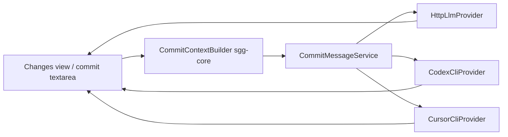

# simple-git-gui (sgg) Roadmap

This document tracks planned work beyond the current MVP.

## Done in MVP (v0.1)

- Cross-platform desktop shell (Windows / macOS / Linux) via Rust + GPUI (gpui-kit)
- Resolve nearest `.git` from the launch path and run git ops against that repo root
- Changes view: status list, stage / unstage, commit
- Sync: push, pull
- Branches: list, create, switch
- Remotes: list
- Shell integration install/uninstall:
  - Windows Explorer context menu ("Open sgg here" / Korean label support)
  - macOS Finder Services / Quick Action for folders
  - Linux file-manager actions / desktop entry for directories

## Planned

### Terminal emulator — shipped in v1.3.0

- Embed a PTY-backed terminal (`portable-pty` + `alacritty_terminal` VTE)
- Bottom dock with tabs; default cwd = repo root
- Shortcuts: `Ctrl+`` / `Ctrl+~` toggle, `Ctrl+Shift+`` / `Ctrl+Shift+~` new tab
- Later: libghostty-vt when Zig is available in the build toolchain; richer ANSI colors / scrollback UI

### History — shipped in v1.4.0

- Linear history list (newest first)
- Select commit to show message, author, date, file list
- Soft/hard/mixed reset (with confirmations)
- Inline blame at the preview caret line (Settings toggle)
- Configurable UI (sans) font in Settings
- Commit graph gutter in the History list (Zed-style lane layout)
- Later: diff against parent

### More git operations

- Fetch (all / selected remote)
- Rebase — see **Rebase (planned)** below
- Merge + conflict status surface
- Cherry-pick
- Tag create / delete / push
- Remote add / rename / remove / set-url

### Rebase (planned)

Goal: rebase the current branch onto another branch (or upstream) from the GUI, with a clear path through conflicts via continue / abort / skip — without dropping to an external terminal for the happy path.

**Core actions**

- **Rebase onto** — pick a local branch (or remote-tracking ref) as the upstream; run `git rebase <onto>` (optional later: `--onto` with an explicit newbase)
- **Rebase continue** — after the user resolves conflicts and stages files, run `git rebase --continue`
- **Rebase abort** — `git rebase --abort` with confirm; restore pre-rebase state
- **Rebase skip** — `git rebase --skip` when the current commit should be dropped during conflict recovery
- **Interactive rebase (later)** — optional `git rebase -i` / todo editor; defer until History or a dedicated reorder UI exists
- **Pull with rebase (later)** — Settings or Pull menu option for `git pull --rebase`

**Conflict / in-progress UX**

- Detect in-progress rebase (`.git/rebase-merge` / `rebase-apply`) on load and after ops; surface a banner or Progress dock entry: “Rebase in progress”
- Changes view while rebasing: emphasize conflicted paths; Stage / continue workflow matches existing conflict handling where possible
- Disable or confirm dangerous actions (switch branch, hard reset) while a rebase is in progress
- Status line / Progress log: started onto `X`, stopped on commit, continued, aborted, completed, or failed

**UI sketch**

- Branches panel: context menu or toolbar action “Rebase onto…” → pick target branch (confirm dialog with busy spinner, same pattern as switch/fetch)
- While rebasing: sticky actions Continue / Skip / Abort near Changes or in the Progress dock
- Optional: show “onto” branch and current stop commit in the banner

**Implementation notes**

- Prefer git CLI (`rebase`, `rebase --continue|--abort|--skip`) via existing core helpers; refresh `RepoSnapshot` (and conflicted change list) after each step
- Wire `BusyKind` variants (`Rebase`, `RebaseContinue`, `RebaseAbort`, `RebaseSkip`) and i18n (en/ko) for labels and confirm copy
- Do not auto-rebase on pull in v1; keep rebase explicit unless the user opts into pull-with-rebase later
- Interactive rebase and rebase of a range from History can wait for the History panel

### Stash (planned)

Goal: stash dirty work from the Changes view and restore it later without leaving the GUI.

**Core actions**

- **Stash push** — save current tracked (and optionally untracked) changes; optional message; confirm when working tree is empty or only untracked
- **Stash pop** — apply latest (or selected) stash and drop it on success; surface conflicts and keep the stash entry if apply fails
- **Stash apply** — same as pop but keep the stash entry
- **Stash drop** — remove one entry (with confirm)
- **Stash list** — show `stash@{n}`, short message, and date in a sidebar panel or Changes toolbar dropdown

**UI sketch**

- Changes toolbar: Stash / Pop actions (busy spinner + confirm dialogs, same pattern as fetch/revert)
- Optional stash panel: list entries; row actions Apply, Pop, Drop; click to preview stash diff later
- Status line / error: conflict and empty-stash feedback via existing `set_ok_status` / `set_error`

**Implementation notes**

- Prefer git CLI (`stash push|pop|apply|drop|list`) via existing core helpers; refresh `RepoSnapshot` after each op
- Wire `BusyKind` variants (`StashPush`, `StashPop`, …) and i18n (en/ko) for labels and confirm copy
- Include untracked (`-u`) as a Settings or confirm checkbox, default off
- Do not auto-stash on branch switch in v1; keep stash explicit from the Changes UI

### Diff UX

- Side-by-side and unified diff for selected file
- Line staging (hunk / line)
- Ignore whitespace toggle

### AI-assisted commit messages (planned)

Goal: generate a commit subject (and optional body) from staged changes in the Changes view, with the same safety model as other tools — **text only**; the user reviews, edits, and commits manually.

**Product UX** (aligned with [Zed Git — AI support](https://github.com/zed-industries/zed/blob/main/docs/src/git.md#ai-support-in-git) and [Cursor Git help](https://cursor.com/help/integrations/git))

- **Generate** control next to the commit `Textarea` (sparkle / magic-wand icon); disabled when there is nothing to describe or a generation is in flight
- Optional shortcut (e.g. bind `GenerateCommitMessage` in a `GitCommit` key context, Zed-style)
- **Busy** state on the button + status line; streaming into the textarea when the backend supports it (HTTP); single-shot fill for CLI backends
- **Preview / edit** — never auto-commit; reuse existing `commit()` path after user confirms
- Settings: preferred backend, model, style (Conventional Commits / repo conventions / custom instructions), separate “light” model for git text vs heavy chat models (see [t3code PR #1171](https://github.com/pingdotgg/t3code/pull/1171))

#### Architecture (sgg)

Split responsibilities the way Zed and t3code do: **git context** in core, **providers** behind a trait, **UI** in `crates/sgg`.



| Layer | Responsibility | sgg touchpoints |
| ----- | -------------- | ------------- |
| Context | Staged (or fallback) diff, file list summary, branch name, recent commit subjects, optional user hint | New helpers on top of `sgg-core` git CLI (`git diff --cached`, `git log -n …`) — same inputs as today’s history/diff code |
| Service | Pick provider from settings, cap prompt size, build prompt, parse `subject` + `body`, sanitize | New `crates/sgg-core` or `crates/sgg` module; async on background thread, result on GPUI loop |
| Providers | Three families below | Trait + registry; settings in Settings page |
| UI | Trigger, streaming/editing, errors | `crates/sgg/src/app/render/changes.rs`, `ops.rs`, i18n |

#### Git context (reference: Zed + t3code)

**Zed** ([`git_panel.rs` — `generate_commit_message`](https://github.com/zed-industries/zed/blob/main/crates/git_ui/src/git_panel.rs)): uses staged diff if any, else working-tree diff; loads recent `git show` messages; compresses/truncates patch (~20 KiB); optional project rules + `commit_message_instructions`; streams via `LanguageModelRegistry` and `commit_message_model` ([docs](https://github.com/zed-industries/zed/blob/main/docs/src/git.md#ai-support-in-git)).

**t3code** ([`GitManager` — `resolveCommitAndBranchSuggestion`](https://github.com/pingdotgg/t3code/blob/main/apps/server/src/git/GitManager.ts)): `prepareCommitContext` → `stagedSummary` (≈8k) + `stagedPatch` (≈50k); `TextGeneration.generateCommitMessage` with optional **policy** (repo conventions, Conventional Commits, custom) ([`textGeneration.ts`](https://github.com/pingdotgg/t3code/blob/main/packages/provider-core/src/server/textGeneration.ts)).

**sgg plan**

- Prefer **`git diff --cached`** when the index has staged paths; otherwise optionally prompt or use unstaged diff (Zed-style fallback)
- **`stagedSummary`**: paths + status short list; **`stagedPatch`**: unified diff with per-file byte budget and line truncation (mirror Zed `compress_commit_diff` / t3 `limitContext`)
- **Recent subjects**: last N commit first lines from `git log` to mimic repo tone (t3 `repo_conventions` mode)
- **User hint**: optional one-line field in the commit area (already have freeform message — treat non-empty subject as “keep / extend” like Zed)

#### Provider backends

##### 1. HTTP LLM API (direct)

Same idea as original roadmap + t3 **text generators** ([`textGeneratorDrivers.ts`](https://github.com/pingdotgg/t3code/blob/main/apps/server/src/textGeneration/textGeneratorDrivers.ts)):

- OpenAI-compatible (`/chat/completions`), Anthropic (`/messages`), OpenRouter, local (Ollama/LM Studio at `http://127.0.0.1:11434/v1`)
- API keys in OS keychain / credential manager (Windows Credential Manager, macOS Keychain, Linux Secret Service); never log prompt bodies in release builds
- Request: system + user messages; ask for **structured** output (`subject`, `body`) via JSON schema or fenced JSON to simplify parsing (t3 uses schema validation end-to-end)
- Use a **small/fast** default model setting independent of any future “heavy” agent model

##### 2. OpenAI Codex (CLI)

Follow t3 **Codex text generation** ([`CodexTextGeneration.ts`](https://github.com/pingdotgg/t3code/blob/main/apps/server/src/textGeneration/CodexTextGeneration.ts)):

- Detect `codex` on `PATH` (configurable binary + `CODEX_HOME`); if missing, surface **platform-specific install help** (see **Missing CLI UX** below)
- Run ephemeral, **read-only** session: `codex exec --ephemeral --skip-git-repo-check -s read-only --output-schema <tmp> --output-last-message <tmp> -` with prompt on stdin
- Disable MCP/plugins/hooks for this invocation so the prompt cannot trigger repo writes (t3’s `CODEX_NO_PLUGIN_ARGS`, MCP off flags)
- Parse JSON from output file; map to `subject` / `body`; timeout (~180s) and buffer limits on stdout/stderr
- Auth: reuse user’s existing Codex login (`codex` OAuth), not sgg-stored API keys

##### 3. Cursor (CLI / Agent)

Cursor documents commit generation from staged diff + history ([Git integrations](https://cursor.com/help/integrations/git)); CLI pattern ([Cursor CLI overview](https://cursor.com/docs/cli/overview)):

- Detect `agent` (or legacy `cursor-agent`) on `PATH`; if missing, surface **platform-specific install help** (see **Missing CLI UX** below)
- **Non-interactive, read-only** generation from repo root:

  ```bash
  git diff --cached | agent -p "Write a Conventional Commits message for these staged changes. Output only the message text." --output-format text
  ```

- Pass explicit instructions: no `git add` / `git commit`; warn on likely secrets in diff (mirror [Cursor commit command template](https://cursor.com/link/command?name=commit))
- Auth: Cursor’s existing session / login — sgg does not store Cursor tokens
- Optional later: `--mode ask` for stricter read-only; keep generation off the full Agent tool loop for latency

##### Missing CLI UX (cross-platform install guidance)

When Settings selects **Codex** or **Cursor**, or Auto would prefer them, and the binary is not found: do **not** fail with a bare “command not found”. Show a Settings / Changes callout with **OS-tailored** install command + official docs link, plus **Copy command** and **Open docs** actions. Detect OS with the same host APIs sgg already uses for shell integration (`cfg!(windows|target_os = "macos"|…)`).

**Detection**

- Resolve binary: Settings override path → `which`/`where` on `PATH` → common install dirs (`~/.local/bin`, `%LOCALAPPDATA%\Programs\…`, Homebrew prefixes)
- Cache result; **Recheck** button after the user installs (PATH may need a new shell — note that in the copy)

**Codex CLI** ([OpenAI Codex CLI docs](https://learn.chatgpt.com/docs/codex/cli.md), [openai/codex README](https://github.com/openai/codex))

| Host OS | Primary install (show first) | Docs / alternatives |
| ------- | ---------------------------- | ------------------- |
| **Windows** | PowerShell: `powershell -ExecutionPolicy ByPass -c "irm https://chatgpt.com/codex/install.ps1 \| iex"` | [Codex CLI](https://learn.chatgpt.com/docs/codex/cli.md); alt: `npm i -g @openai/codex` |
| **macOS** | Terminal: `curl -fsSL https://chatgpt.com/codex/install.sh \| sh` | Same docs; alt: `brew install --cask codex`, or npm |
| **Linux** (incl. WSL2) | Shell: `curl -fsSL https://chatgpt.com/codex/install.sh \| sh` | Same docs; alt: npm; note WSL1 unsupported for Codex |

Also link **Open docs** → `https://chatgpt.com/codex` / CLI quickstart; after install, remind user to sign in with `codex` once.

**Cursor CLI** ([Cursor CLI overview](https://cursor.com/docs/cli/overview))

| Host OS | Primary install (show first) | Docs |
| ------- | ---------------------------- | ---- |
| **Windows** | PowerShell: `irm 'https://cursor.com/install?win32=true' \| iex` | [CLI overview](https://cursor.com/docs/cli/overview) |
| **macOS / Linux / WSL** | Shell: `curl https://cursor.com/install -fsS \| bash` | Same docs |

After install, the entry point is `agent` (legacy `cursor-agent` still accepted for detection). Open docs URL: `https://cursor.com/docs/cli/overview`.

**UI sketch**

- Settings → Commit messages → backend row: status chip `Installed` / `Not found`
- When **Not found**: expandable panel with (1) one-line reason, (2) **copyable** platform command, (3) **Open install docs** (system browser), (4) optional secondary alts collapsed under “Other ways”
- i18n (en/ko): command strings stay English (shell); surrounding labels localized
- Prefer **copy + open link** over running installers from inside sgg (no elevated install automation in v1)

##### Provider selection and fallback

Mirror t3 [`TextGeneration.ts`](https://github.com/pingdotgg/t3code/blob/main/apps/server/src/textGeneration/TextGeneration.ts):

1. If Settings pick **HTTP text generator** → use HTTP driver only for commit messages  
2. Else if **Codex** configured and installed → `CodexCliProvider`  
3. Else if **Cursor CLI** detected → `CursorCliProvider`  
4. Else → disabled with clear Settings copy; if the chosen backend is Codex/Cursor but missing, show the **Missing CLI UX** panel (not only “offline / no provider”)

Expose priority in Settings (e.g. “Commit message backend: Auto | HTTP | Codex | Cursor”) and per-backend model/overrides.

#### Prompting and style

Centralize prompt templates (Zed: [`commit_message_prompt.txt`](https://github.com/zed-industries/zed/tree/main/crates/git_ui/src); t3: `buildCommitMessagePrompt` in provider-core):

- Modes: **Conventional Commits**, **repo conventions** (examples from recent subjects), **custom instructions** (global + per-repo file later)
- Output: imperative subject, optional body; respect user’s Udacity / Conventional Commits preference in instructions
- Include branch name only when generating branch suggestions (t3 optional `includeBranch`; out of scope for v1 commit-only UI)

#### Security and reliability

- **Never** send unstaged secrets by default; optional “include unstaged” with confirmation
- Redact or skip paths matching `.env`, `*.pem`, credentials (heuristic + user toggle)
- Cap diff bytes; fail gracefully with “diff too large — narrow staging” 
- Cancel in-flight generation when repo changes or user clears staging
- Telemetry: local-only counters unless user opts in (no diff content)

#### Implementation phases

1. **Trait + HTTP provider** — end-to-end from Changes UI with keychain + preview  
2. **Codex CLI provider** — subprocess adapter, structured JSON, Settings for binary path + **Missing CLI UX** (Windows / macOS / Linux install commands + docs links)  
3. **Cursor CLI provider** — `agent -p` adapter, PATH detection + same **Missing CLI UX** for Cursor installers  
4. **Polish** — streaming HTTP, repo convention mode, commit title length warning (Zed modal pattern), Recheck after install

#### References (upstream)

| Topic | Repository | Primary files |
| ----- | ---------- | ------------- |
| UI action, diff limits, streaming, recent commits | [zed-industries/zed](https://github.com/zed-industries/zed) | [`crates/git_ui/src/git_panel.rs`](https://github.com/zed-industries/zed/blob/main/crates/git_ui/src/git_panel.rs), [`crates/git_ui/src/commit_modal.rs`](https://github.com/zed-industries/zed/blob/main/crates/git_ui/src/commit_modal.rs), [`docs/src/git.md`](https://github.com/zed-industries/zed/blob/main/docs/src/git.md) |
| Orchestration, staged caps, style policy | [pingdotgg/t3code](https://github.com/pingdotgg/t3code) | [`apps/server/src/git/GitManager.ts`](https://github.com/pingdotgg/t3code/blob/main/apps/server/src/git/GitManager.ts), [`apps/server/src/textGeneration/TextGeneration.ts`](https://github.com/pingdotgg/t3code/blob/main/apps/server/src/textGeneration/TextGeneration.ts), [`apps/server/src/textGeneration/CodexTextGeneration.ts`](https://github.com/pingdotgg/t3code/blob/main/apps/server/src/textGeneration/CodexTextGeneration.ts), [`packages/provider-core/src/server/textGeneration.ts`](https://github.com/pingdotgg/t3code/blob/main/packages/provider-core/src/server/textGeneration.ts), [`docs/user/text-generation.md`](https://github.com/pingdotgg/t3code/blob/main/docs/user/text-generation.md) |
| Cursor product behavior + CLI install | [cursor.com](https://cursor.com) | [Git help](https://cursor.com/help/integrations/git), [CLI overview / install](https://cursor.com/docs/cli/overview) |
| Codex CLI install (per OS) | [openai/codex](https://github.com/openai/codex) | [Codex CLI docs](https://learn.chatgpt.com/docs/codex/cli.md), [README quickstart](https://github.com/openai/codex/blob/main/README.md) |

### CLI

- Ship / expose `sgg` as a command-line entry point (on `PATH` after install)
- Open a repository from the shell: `sgg [path]` (omit path → empty start / pick folder in UI; with path → nearest `.git`)
- Common flags: `--help`, `--version`, optional `--page git|files|settings`
- Headless-friendly error messages when path is not a git repo
- Document install paths so shells and agents can invoke the same binary as the GUI

### Packaging

- Smaller release binary (`LTO`, strip, size-oriented profile)
- Windows installer (optional context-menu registration)
- macOS `.app` bundle + notarization notes
- Linux AppImage / `.deb`

### Polish

- Keyboard shortcuts (stage, commit, push, pull, refresh)
- Multi-repo recent list
- Theme (light/dark) following OS when possible
- Localization (en / ko) for UI strings

### Future

- Embed / reuse the editor stack used by [Zed](https://zed.dev) (Zed’s editor component) for in-app file editing and preview, replacing or extending the current basic text preview
